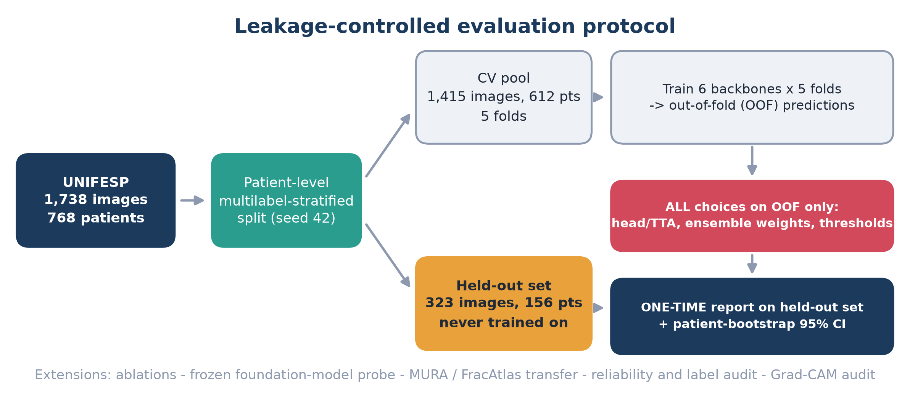
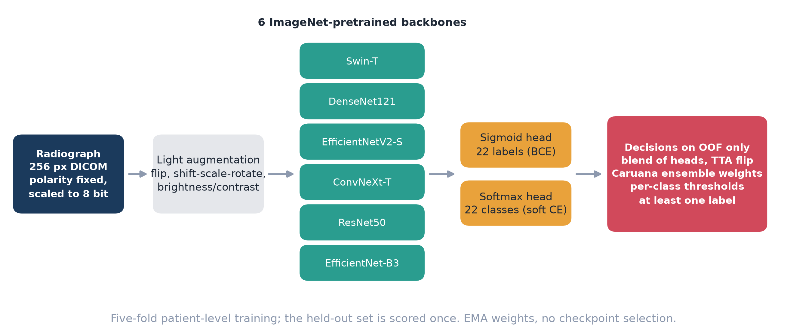
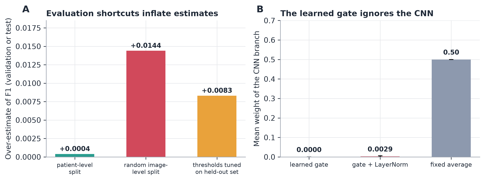
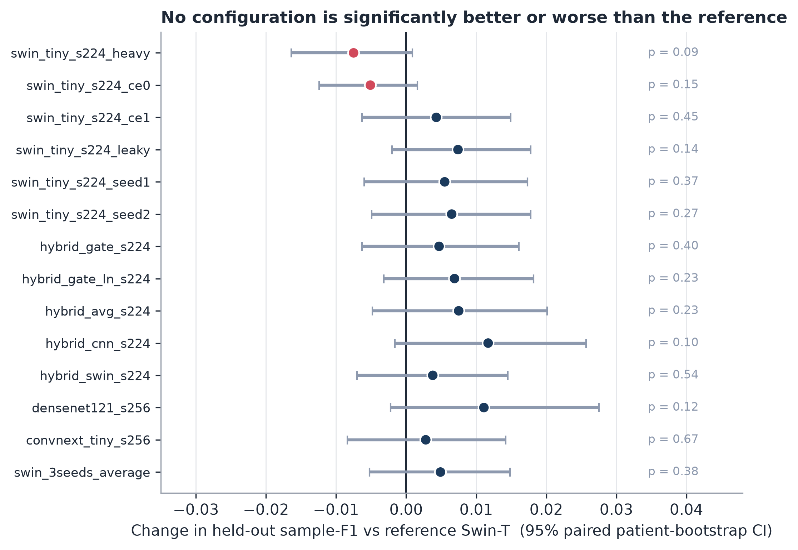
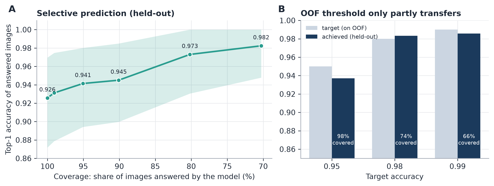
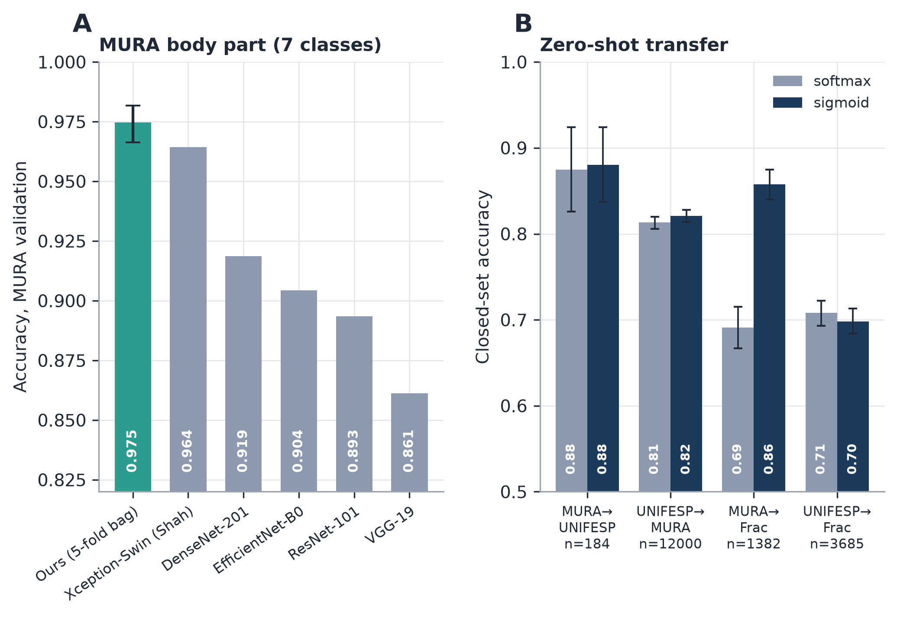
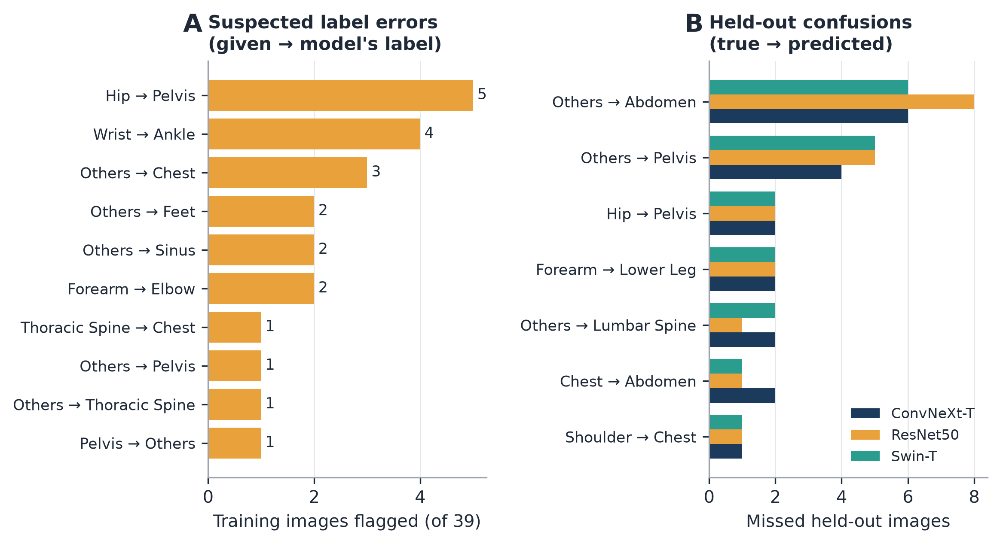

# Leakage-controlled benchmarking of radiograph body-part classification

**Reliability, label audit, explainability and cross-dataset transfer on public data.**

[](https://doi.org/10.5281/zenodo.24027438)


Sheikh Noor Abdullah ([ORCID 0009-0002-7193-4284](https://orcid.org/0009-0002-7193-4284)) and A.B.M. Kabir Hossain  
Department of Information and Communication Engineering, Bangladesh Army University of Engineering & Technology (BAUET), Natore, Bangladesh.  
Funding: none. Status: manuscript submitted / under review for journal publication.

> **This repository makes no state-of-the-art claim.** What it offers is a transparent evaluation protocol, honest negative results, and tools for judging whether a body-part classifier can be trusted in a routing role.

<p align="center">
  
</p>

---

## Contents
1. [The Question](#the-question)
2. [Main Findings](#main-findings)
3. [Key Figures](#key-figures)
4. [Repository Layout](#repository-layout)
5. [Data (Not Included)](#data-not-included)
6. [Reproduce](#reproduce)
7. [Notebooks](#notebooks)
8. [Honest Limitations](#honest-limitations)
9. [Cite](#cite)
10. [Licence and Responsible Use](#licence-and-responsible-use)

---

## The Question
Published accuracies for radiograph body-part classification are hard to compare. Splits, thresholds and uncertainty are rarely described, and most large studies use private data. Two shortcuts are known to inflate results in other fields: leakage between images of the same patient, and thresholds or checkpoints chosen on the data that is later scored. We measured how large these effects are for body-part classification, on public data, under a protocol that rules them out:

* **Patient-level, multilabel-stratified split** of the UNIFESP body-part dataset (22 classes, 1,738 labelled radiographs, 768 patients): a fixed held-out set of 323 images / 156 patients and a cross-validation pool of 1,415 images / 612 patients in five folds.
* **Every decision on out-of-fold (OOF) predictions only**: head and test-time-augmentation variant, ensemble weights (Caruana selection), per-class thresholds, the minimum-one-label rule. The held-out set is scored once.
* **Patient-cluster bootstrap** confidence intervals and paired patient-bootstrap tests for every comparison.

---

## Main Findings
All numbers come from files in [`experiments/results/`](experiments/results/); the full list with sources is in [`experiments/PAPER_FACTS.md`](experiments/PAPER_FACTS.md).

| Topic | Result |
|---|---|
| Held-out ensemble (UNIFESP) | sample-mean F1 **0.9189** [0.8669, 0.9602]; ensemble minus best single model +0.0066 [-0.0002, +0.0142], p = 0.063 |
| Ablations (augmentation, loss, backbone, seed, fusion, split type) | no configuration significantly better or worse than the reference (all p > 0.08); seed-to-seed spread is as large as most effects |
| Evaluation shortcuts | a random image-level split over-estimates validation F1 by **0.0144** (patient-level folds: 0.0004); tuning thresholds on the scored set adds **+0.0083** |
| CNN-Transformer gated fusion | the learned gate gives the CNN branch a weight of 0.0000 / 0.0029: it collapses onto the Transformer |
| Frozen DINOv2-S linear probe | held-out 0.8859 [0.8327, 0.9318], still improving with more labelled data |
| MURA body part (official validation split, 3,197 images) | accuracy 0.9747 [0.9663, 0.9818], macro-F1 0.9707; the one published figure we found for this task is 0.9643 / 0.9574 (Shah et al., 2026) |
| Zero-shot transfer through an explicit class map | 0.69 to 0.88 depending on pair and head (image-level CIs, optimistic) |
| Reliability | ECE 0.0545 (already calibrated; temperature scaling barely helps); 94.5 % accuracy on the 90 % of images kept at 90 % coverage |
| Label audit | 39 of 1,415 training images (2.8 %) flagged as suspected label errors; **not reviewed by a clinician** |
| Kaggle (late submissions, unranked) | private 0.92563 (Stage 1) and 0.92638 (Stage 2); between 2nd (0.92787) and 3rd (0.92488); first place is 0.93378; one private score has a standard error of about 0.012 |
| Stage 2 (OOF on all 1,738 images) | plain 0.9262, pseudo-labelled 0.9233, union 0.9279; differences not significant |

**Take-away:** how a classifier is evaluated mattered more than its architecture. Gains from fusion, ensembling and pseudo-labelling stayed within the noise of a 323-image held-out set.

---

## Key Figures
<table>
<tr>
<td width="50%"><br><sub><b>Models and decision pipeline.</b> Six backbones, sigmoid and softmax heads, five patient-level folds.</sub></td>
<td width="50%"><br><sub><b>Shortcuts and the gate.</b> Leaky split and held-out tuning inflate scores; the gate ignores the CNN.</sub></td>
</tr>
<tr>
<td><br><sub><b>Ablations.</b> No interval excludes zero.</sub></td>
<td><br><sub><b>Selective prediction.</b> Accuracy against coverage, and how OOF-chosen targets transfer.</sub></td>
</tr>
<tr>
<td><br><sub><b>MURA and zero-shot transfer.</b> Charts only; no MURA images are redistributed.</sub></td>
<td><br><sub><b>Label audit and confusions.</b> Suspected errors are suspects, not proven errors.</sub></td>
</tr>
</table>

---

## Repository Layout
| Path | Content |
|---|---|
| `ready_to_run/` | Self-contained, ready-to-run Jupyter/Kaggle notebooks for full replication |
| `kaggle_notebooks/` | Interactive Kaggle experiments, holdout CV, ensemble models, and exports |
| `experiments/v2/src/` | Modular Python codebase: training, ensembling, evaluation, ablations, cross-transfer, reliability, Grad-CAM |
| `experiments/results/` | Evaluation JSONs, CSVs, and logs from validation and held-out runs |
| `experiments/figures/` | High-resolution publication figures (PNG, PDF) |
| `experiments/Figures_for_upload/` | Individual high-res manuscript figures prepared for journal upload |
| `experiments/submission/` | Manuscript draft (`.docx`, compiled `.pdf`), title page, cover letter, highlights, and checklist |
| `experiments/latex/` | Complete LaTeX manuscript sources, Overleaf zip archive, and bibliography |
| `experiments/` scripts | Reproducibility builders (`evalkit.py`, `make_paper_tables.py`, `make_figures.py`, etc.) |

---

## Data (Not Included)
| Dataset | Source | Terms |
|---|---|---|
| UNIFESP X-Ray Body Part Classification | [Kaggle](https://www.kaggle.com/datasets/felipekitamura/unifesp-xray-bodypart-classification) (doi:10.34740/KAGGLE/DSV/3399135) | CC BY-NC-SA 4.0 |
| MURA v1.0 | Stanford AIMI, [Redivis](https://stanford.redivis.com/datasets/cv1a-apytk3j44) | Stanford Dataset Research Use Agreement (non-commercial, **no redistribution**) |
| COVID-19 Radiography Database | [Kaggle](https://www.kaggle.com/datasets/tawsifurrahman/covid19-radiography-database) | Belongs to original authors |
| FracAtlas | [Figshare](https://doi.org/10.6084/m9.figshare.22363012) | CC BY 4.0 |

> **Notice:** Under Stanford and UNIFESP distribution policies, raw patient images are not redistributed in this repository.

---

## Reproduce
```bash
# 1. Build index and patient-level splits
python -m experiments.v2.src.build_index
python -m experiments.v2.src.make_splits
python -m experiments.v2.src.make_holdout_cv_splits --holdout_fold 4

# 2. Rebuild paper tables and figures from evaluation results
python experiments/make_paper_tables.py --root experiments/results --out experiments/results/paper_tables.md
python experiments/make_figures.py
```

Split fingerprints (SHA-256):
- `index.csv`: `04cc621c95e8a353a665c4a2014b16045a4c6a14af0b944ca9ca9a4ad68a4b8a`
- `splits/folds.csv`: `ff44019bf2799d906acbbbe4d8e48f1228f244095a21e768ff9a74a64f36f36a`

---

## Notebooks
The project includes ready-to-run notebooks in [`ready_to_run/`](ready_to_run/):
- `UNIFESP_v2_cross.ipynb`: Cross-dataset transfer
- `UNIFESP_v2_mura.ipynb`: MURA evaluation
- `UNIFESP_v2_covid.ipynb`: COVID-19 Radiography transfer
- `UNIFESP_v2_cross_fracatlas.ipynb`: FracAtlas transfer
- `UNIFESP_v2_fm_probe.ipynb`: Foundation model (DINOv2) linear probe
- `UNIFESP_v2_explain.ipynb`: Grad-CAM explainability and gate inspection
- `UNIFESP_v2_reliability.ipynb`: Calibration (ECE) and selective prediction
- `UNIFESP_v2_stage2_boost.ipynb`: Stage 2 pseudo-labeling / test ensemble

---

## Honest Limitations
* Single-centre dataset: the 323-image held-out set has only 1 to 6 positives for several rare classes, so per-class estimates carry uncertainty.
* COVID-19 and FracAtlas experiments use image-level splits (optimistic).
* Class maps used for cross-dataset transfer, and label-audit suspects, have not been reviewed by a clinician.
* Pseudo-labelling uses unlabelled test images (transductive).
* Model checkpoints are not bundled (regenerate via the reproducible training scripts/notebooks).

---

## Cite
```bibtex
@article{abdullah2026bodyparts,
  title   = {Leakage-controlled benchmarking of radiograph body-part classification: reliability, label audit, explainability and cross-dataset transfer on public data},
  author  = {Abdullah, Sheikh Noor and Hossain, A.B.M. Kabir},
  year    = {2026},
  journal = {Computerized Medical Imaging and Graphics},
  note    = {Under Review},
  doi     = {10.5281/zenodo.24027438},
  url     = {https://github.com/NoorAbdullah02/Body_parts}
}
```

---

## Licence and Responsible Use
- **Code:** MIT License (see [`LICENSE`](LICENSE)).
- **Datasets:** Keep their respective original licenses (UNIFESP: CC BY-NC-SA 4.0; MURA: Stanford Research Use Agreement; FracAtlas: CC BY 4.0).
- **Disclaimer:** This software is for academic research only and is not intended or certified as a medical device for clinical diagnosis.
